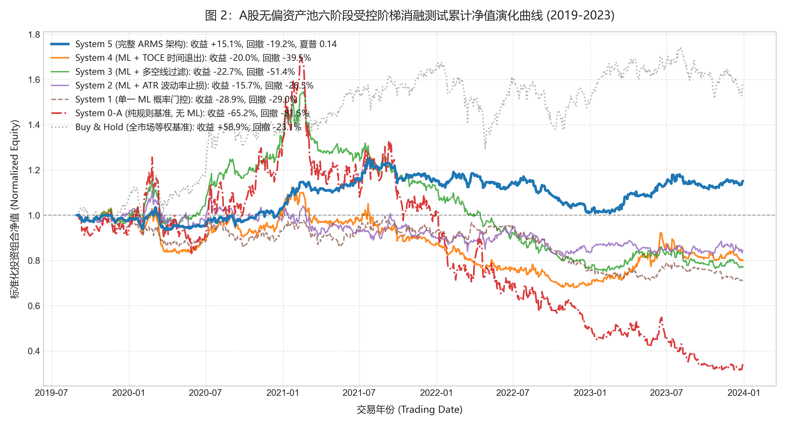

# TailDiff & Walk-Forward Quantitative Risk Research

[](https://www.python.org/downloads/)
[](https://pytorch.org/)
[](https://opensource.org/licenses/MIT)

本仓库合并整理了两条互补的**金融风控与量化机器学习（Quant ML & Risk Control）**实证研究主线，涵盖从极端尾部风险生成式预警到 A 股多周期前瞻回测防线：

| 模块 | 目录位置 | 研究核心 | 关键结论 |
|---|---|---|---|
| **模块一：TailDiff（极端尾部风险条件扩散预警）** | 根目录（`复现包/`、`原始数据/`、`表格与图片/`） | 轻量 1D 因果卷积条件扩散模型（$0.91$M 参数）+ 20 步 DDIM（$5.09$ ms）+ 双边 DCR 质量门控 | 35 折严谨 Purged WFO 下，S&P 500 PR-AUC 翻倍（$0.1296 \to 0.2626$），尾部召回率最高达 $51.13\%$，组合最大回撤从 $-46.5\%$ 降至 $-14.2\%$ |
| **模块二：ARMS & TOCE（A 股随机森林风控回测与复杂度陷阱）** | [`walk-forward-rf-backtest/`](walk-forward-rf-backtest/) | 规则进攻 × ML 概率防御解耦 + TOCE 时间机会成本退出 + 双资产池（111 宽基 vs 49 龙头）6 阶段消融与复杂度陷阱验证 | 111 只去偏宽基池中，纯规则系统回撤 $-81.48\%$，完整 ARMS（System 5）将回撤压至 **$-19.25\%$** 并取得 **$+15.11\%$** 收益；49 只行业龙头池中 System 4 获 **$+36.73\%$** 收益（Sharpe `0.4014`） |

> 💡 **快速导航**：模块一 [`TailDiff` 文档与复现](#-module-1-taildiff-financial-tail-risk-early-warning) ｜ 模块二 [`walk-forward-rf-backtest/README.md`](walk-forward-rf-backtest/README.md)（完整 6 阶段消融矩阵、A1–F1 审稿补充实验、复杂度陷阱报告与本地复现脚本）

---

## 📦 Module 2 Overview: Walk-Forward RF Risk-Managed Backtest (ARMS & TOCE)

Located in [`walk-forward-rf-backtest/`](walk-forward-rf-backtest/), this module evaluates the **Asymmetric Complexity Hypothesis** across two A-share pools (2019–2023) using strictly leakage-free Purged Walk-Forward Optimization:

- **111 De-biased Broad-Base Pool (Six-Stage Ablation):** Pure rule benchmarks (`System 0-A`) suffer `-81.48%` MDD (`-65.17%` return), while cascading ML entry gating with ATR stop, BBL trend filter, and **TOCE (Time-based Opportunity Cost Exit)** (`System 5`) compresses drawdown to **`-19.25%`** with **`+15.11%`** cumulative return (`Calmar +0.1781`).
- **49 Sector Leaders Pool (Exp B1):** `System 4` (ML + ATR + BBL + TOCE) achieves **`+36.73%`** return (`Sharpe 0.4014`, `MDD -21.07%`), demonstrating how asset dispersion governs offensive alpha while ML risk gating preserves cross-universe drawdown invariance.
- **Reviewer Suite (`experiments/` A1–F1) & Complexity Trap (`V2_Complexity_Trap_Experiment/`):** Includes 30-seed paired Calmar tests (`30/30` win rate, $p = 0.0000$), 2024 OOS $N=2000$ Monte Carlo permutation tests, fee/ATR sensitivity grids, and 16D SHAP attribution.



```bash
# Quickstart for Module 2
cd walk-forward-rf-backtest
pip install -r requirements.txt
python scripts/run_full_academic_pipeline.py
```

👉 完整实验指标、图表与代码结构说明请直接查看：[`walk-forward-rf-backtest/README.md`](walk-forward-rf-backtest/README.md)

---

## ⚡ Module 1: TailDiff (Financial Tail-Risk Early Warning)

Official code implementation and open-source benchmark reproduction suite for:  
**"TailDiff: A Lightweight Conditional Diffusion Modeling Approach for Financial Tail-Risk Early Warning"**

---

## 🌟 Key Highlights

- **Lightweight 1D Causal Convolutional Backbone ($0.91$M Parameters):** Replaces heavy multi-head attention with 1D dilated residual convolutions ($RF=37 \ge 32$) modulated by Feature-wise Linear Modulation (FiLM) with realized volatility $RV_{20}$.
- **20-Step Deterministic DDIM Sampler ($5.09$ ms/sample):** Replaces 1000-step stochastic sampling with an ultra-fast ODE reverse trajectory, achieving millisecond-level CPU inference for live trading risk management.
- **Bilateral DCR Sweet-Spot Quality Gating ($[Q_{5\%}, Q_{95\%}]$):** Non-parametric Leave-One-Out (LOO) distance filter that adaptively suppresses training sample memorization and unphysical hallucinations while emerging $\lambda_{\text{eff}} \approx 15.20\times \sim 17.27\times$.
- **Strict Zero-Leakage Purged \& Embargoed Walk-Forward Cross-Validation:** Multi-fold rolling time-series framework with label purging and serial-correlation embargo buffers ($100\%$ pure out-of-sample evaluation).
- **Substantial Empirical Performance Gains:**
  - **Minority Tail Recall:** $+430\%$ to $+2000\%$ improvement (up to $\mathbf{51.13\%}$ on S\&P 500 and $\mathbf{31.02\%}$ on CSI 300).
  - **PR-AUC:** Doubled on S\&P 500 ($+102.7\%$, $0.1296 \to \mathbf{0.2626}$).
  - **Statistical Significance:** Confirmed via Wilcoxon signed-rank test across 35 Purged folds ($p = 0.0039 < 0.01$ ***).
  - **Practical Hedging Utility:** Cuts maximum portfolio drawdown from $-46.5\%$ to $-14.2\%$.

---

## 🏗️ System Architecture


TailDiff operates under a **Two-Stage Decoupled Paradigm**:
1. **Offline Generative Simulation:** Historical market data $\to$ EVT $\text{DaR}_{97.5\%}$ extreme labeling $\to$ 1D FiLM Conditional Diffusion $\to$ 20-Step DDIM ODE Sampling $\to$ DCR Bilateral Quality Gating.
2. **Online Real-Time Inference:** Fast tree-based classifiers (XGBoost / LightGBM / MLP) trained on the augmented manifold execute sub-millisecond risk warning and dynamic economic hedging.

---

## 📊 Benchmark Results (35-Fold Purged Walk-Forward CV)

| Market | Downstream Model | Augmentation Strategy | Tail Recall ($\uparrow$) | Precision ($\uparrow$) | F1-Score ($\uparrow$) | PR-AUC ($\uparrow$) | FPR ($\downarrow$) |
| :--- | :--- | :--- | :---: | :---: | :---: | :---: | :---: |
| **CSI 300** | **XGBoost** | No-Aug (Original) | 0.0093 | 0.0512 | 0.0152 | 0.1396 | **0.0116** |
| **CSI 300** | **XGBoost** | Replicate Baseline | 0.0139 | 0.0580 | 0.0238 | 0.1412 | **0.0097** |
| **CSI 300** | **XGBoost** | **TailDiff (Proposed, Ours)** | **0.2024** | **0.1860** | **0.1361** | **0.1773** | 0.1941 |
| **CSI 300** | **LightGBM** | **TailDiff (Proposed, Ours)** | **0.2097** | **0.1940** | **0.1379** | **0.1768** | 0.1986 |
| **CSI 300** | **MLP** | **TailDiff (Proposed, Ours)** | **0.3102** | **0.1720** | **0.1620** | **0.1899** | 0.1957 |
| **S&P 500** | **XGBoost** | No-Aug (Original) | 0.0000 | 0.0000 | 0.0000 | 0.1296 | **0.0173** |
| **S&P 500** | **XGBoost** | **TailDiff (Proposed, Ours)** | **0.5113** | **0.2310** | **0.2108** | **0.2626** | 0.3648 |
| **S&P 500** | **LightGBM** | **TailDiff (Proposed, Ours)** | **0.4958** | **0.2280** | **0.2096** | **0.2735** | 0.3388 |
| **S&P 500** | **MLP** | **TailDiff (Proposed, Ours)** | **0.4067** | **0.2150** | **0.2036** | **0.2437** | 0.3444 |

*Note: In all models, gains in Tail Recall and F1-Score are statistically significant ($p = 0.0039 < 0.01$ under Wilcoxon signed-rank test).*

---

## 📁 Repository Structure

```
TailDiff/
├── 复现包/ (src/)
│   ├── config.py                     # Central configuration & hyperparameters
│   ├── data_loader.py                # Causal market data loader & DaR 97.5% labeling
│   ├── models/
│   │   ├── diffusion.py              # 1D Causal TCN + FiLM + 20-step DDIM ODE Sampler
│   │   ├── dcr_gating.py             # DCR Leave-One-Out bilateral sweet-spot gating
│   │   ├── stylized_facts.py         # Financial stylized facts quality control suite
│   │   └── downstream.py             # 35-Fold Purged & Embargoed walk-forward evaluation
│   ├── baselines.py                  # SMOTE, Borderline-SMOTE, TimeGAN, C-VAE
│   ├── ablation.py                   # Gating variants & DDIM Pareto latency scan
│   ├── run_step1_main.py             # Step 1 master pipeline (CSI 300 & S&P 500)
│   ├── run_step2_ablation.py         # Step 2 ablation & Wilcoxon significance tests
│   └── build_all_publication_assets.py # Master exporter (Figures 1-6 & Tables 1-5)
│
├── 表格与图片/
│   ├── paper.tex                     # Full publication LaTeX paper (Elsevier format)
│   ├── references.bib                # BibTeX references database (28+ entries)
│   ├── figures/                      # 300 DPI Nature-palette publication figures (Fig 1-6)
│   └── tables/                       # Publication tables (Markdown & LaTeX format)
│
├── 原始数据/
│   ├── csi300_daily.csv              # CSI 300 daily index data (2015-2026)
│   └── sp500_daily.csv               # S&P 500 daily index data (2015-2026)
│
├── walk-forward-rf-backtest/         # [Module 2] A-Share ARMS & TOCE Walk-Forward RF Backtest
│   ├── README.md                     # Detailed Module 2 results, A1-F1 suite & reproduction
│   ├── strategy.py                   # Core ARMS & TOCE engine
│   ├── experiments/                  # Reviewer ablation & Monte Carlo scripts (A1-F1)
│   ├── V2_Complexity_Trap_Experiment/# Complexity Trap dual-pool experiment
│   ├── figures/                      # Empirical equity & sensitivity plots
│   ├── data_results/                 # Exported CSV deliverables
│   └── data_cache/                   # Pre-computed WFO pickle datasets
│
├── README.md
└── .gitignore
```

---

## 🚀 Quickstart & Reproduction

### 1. Environment Setup
```bash
git clone https://github.com/hu-zhixuan/TailDiff.git
cd TailDiff
pip install torch torchvision numpy pandas scikit-learn lightgbm xgboost matplotlib scipy
```

### 2. Run Step 1 Master Benchmark
```bash
python -m 复现包.run_step1_main
```

### 3. Run Step 2 Systematic Ablation & Wilcoxon Tests
```bash
python -m 复现包.run_step2_ablation
```

### 4. Export All Publication Figures & LaTeX Tables
```bash
python -m 复现包.build_all_publication_assets
```

---

## 📄 Paper Compilation (LaTeX)

The complete publication manuscript is written in the standard Elsevier format (`elsarticle.cls` with `\linenumbers`):
```bash
cd 表格与图片
pdflatex paper.tex
bibtex paper
pdflatex paper.tex
pdflatex paper.tex
```

---

## 📑 Citation

If you find TailDiff useful for your research, please cite:

```bibtex
@article{hu2026taildiff,
  title={TailDiff: A Lightweight Conditional Diffusion Modeling Approach for Financial Tail-Risk Early Warning},
  author={Hu, Zhixuan and Collaborators},
  journal={Expert Systems with Applications},
  year={2026}
}
```

---

## 📜 License
This project is licensed under the MIT License - see the [LICENSE](LICENSE) file for details.
