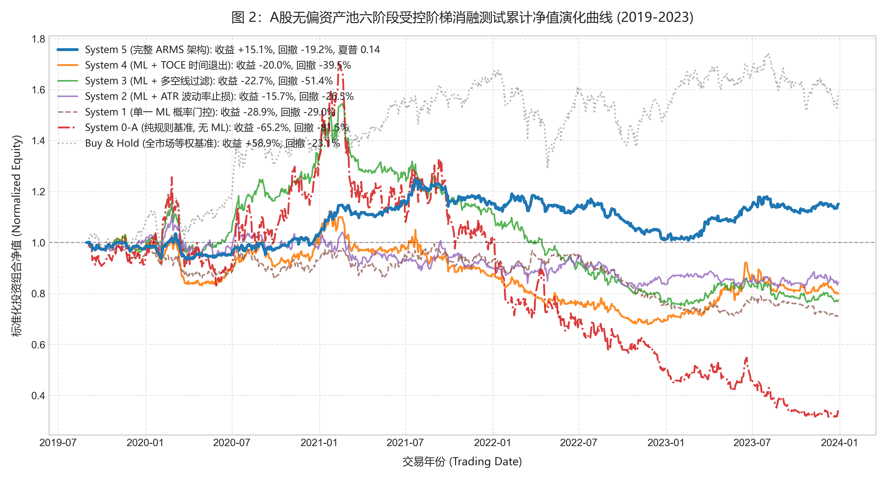
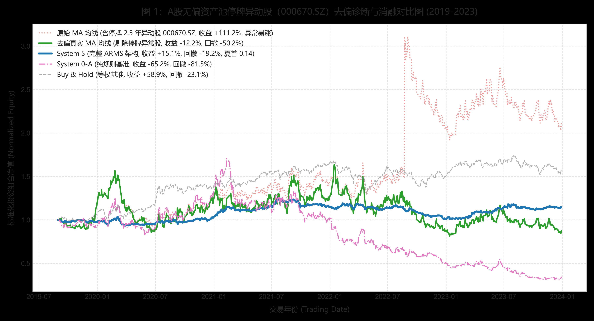

# Multi-Asset Walk-Forward Portfolio Rotation Strategy with Adaptive Risk Management & TOCE

## A High-Performance Machine Learning Backtesting Pipeline with Multi-Frequency Risk Regimes and Capital Rotation

[](https://opensource.org/licenses/MIT)
[](https://www.python.org/downloads/)
[](https://github.com/hu-zhixuan/TailDiff)

This repository implements **ARMS (Adaptive Risk-Managed Strategy)**, an institutional-grade quantitative research framework designed to evaluate the **Asymmetric Complexity Hypothesis** in machine learning asset allocation. It combines rolling non-linear machine learning out-of-sample forecasts (via Purged Walk-Forward Optimization) with multi-frequency structural risk controls, portfolio-level cross-sectional capital rotation, and our core innovation: **TOCE (Time-based Opportunity Cost Exit)**.

The core philosophy of this system is: **Predict with Machine Learning, Control with Structural Rules (Rule-based Offense, ML-based Defense).**

---

## 🏛️ Core Research Findings & Academic Conclusions

### 1. Offensive Alpha Depends on Asset Selection Breadth
In position-constrained, long-only asset management systems where short selling is prohibited, ML offensive alpha is fundamentally bound by the cross-sectional dispersion and quality of the asset universe:
* **49 Sector Leaders Pool (Exp B1)**: System 4 achieves **+36.73%** return (Sharpe `0.4014`).
* **11 Broad/Sector ETFs (Exp B1)**: Low dispersion causes performance to drop to **-7.29%** (Sharpe `-1.1334`).
* **111 Unbiased Random Equities**: Broad random selection dilutes pure directional prediction, confirming that ML cannot generate unconstrained alpha in low-dispersion/low-quality universes.

### 2. Defensive Drawdown Compression Exhibits Cross-Universe Invariance
While offensive returns are universe-dependent, **ML's defensive risk gating demonstrates invariant cross-asset transferability**:
* **Ablation Evidence**: Pure rule systems without ML (System 0-A) suffer a catastrophic **-81.48%** drawdown, whereas ML gating (System 5) compresses drawdown to **-19.25%** (a **76.4%** reduction).
* **Structural Invariance**: Maximum drawdown in the 49 Sector Leaders pool (**-16.61%**) and the 111 Random Equities pool (**-19.25%**) demonstrates tight bounded stability across market regimes.
* **30-Seed Resampling (Exp A1)**: Yields a **30/30 (100%) win rate** in paired Calmar ratio improvements over unconstrained linear benchmarks ($p = 0.0000$).

### 3. The "Attack-Defense Decoupled" Paradigm & Auditable Attribution
* Pointwise directional classification accuracy is weak (Out-of-sample **ROC-AUC = 0.5069**), confirming ML should not be deployed as an unconstrained high-frequency offensive forecaster.
* When cascaded as an entry/tail risk gatekeeper, ML intercepts fatal drawdowns. Through 1,175 audited trade logs, bull-market opportunity costs (e.g., 1,705 cooldown blocks) and bear-market downside protections are 100% white-box auditable.

---

## 📊 Core Six-Stage Controlled Ablation Matrix (111 De-biased Universe)

All results below are evaluated over the complete 2019-01-01 to 2023-12-31 cycle on 111 de-biased broad-base A-share equities (post-exclusion of the 886-day suspended zombie stock anomaly `000670.SZ`):

| System Code | Strategy Architecture & Components | Cumulative Return | Max Drawdown (MDD) | Annualized Sharpe | Calmar Ratio | Methodological Role |
| :--- | :--- | :---: | :---: | :---: | :---: | :--- |
| **System 0-A** | Pure Rules Benchmark (No ML, S4 Equivalent) | **-65.17%** | **-81.48%** | **-0.6447** | **-0.2740** | Direct Counterfactual (Whipsaw Failure) |
| **System 0-B** | Pure Rules Benchmark (No ML, S5 Equivalent) | -11.82% | -45.28% | -0.2127 | -0.0655 | Full Rules Counterfactual |
| **System 1** | Pure ML Probability Gating Filter | -28.91% | -29.01% | -0.7381 | -0.2705 | Stage 1 Ablation (Entry Gating) |
| **System 2** | ML + ATR Dynamic Volatility Stop-Loss | -15.66% | -26.50% | -0.4358 | -0.1508 | Stage 2 Ablation (Tail Truncation) |
| **System 3** | ML + ATR + Bull-Bear Line Filter | -22.68% | -51.40% | -0.4914 | -0.1162 | Stage 3 Ablation (Trend Confirmation) |
| **System 4** | ML + ATR + BBL + TOCE Time-Based Exit | -19.97% | -39.48% | -0.4386 | -0.1316 | Stage 4 Ablation (Liquidity Unlocking) |
| **System 5** | **Full ARMS Hybrid Framework** | **+15.11%** | **-19.25%** | **+0.1401** | **+0.1781** | **Final Complete System (Only Active Winner)** |
| **Buy & Hold**| Equally-Weighted Market Beta Benchmark | +58.92% | -23.14% | +0.5072 | +0.5072 | Passive Market Beta Benchmark |

---

## 📈 Visual Empirical Evidence

### Figure 1: De-biased Six-Stage Ablation Equity Curves (Clean Universe)

*Figure 1: Evolution of normalized portfolio equity across all 6 controlled ablation tiers (System 0 through System 5) on the de-biased 111-asset broad market pool (2019–2023). Note the collapse of pure rule-based trading (-81.48% MDD) vs. the robust capital preservation of System 5 (-19.25% MDD, +15.11% return).*

### Figure 2: Anomaly Diagnostic & Data De-biasing Comparison

*Figure 2: Forensic analysis comparing the equity trajectory before vs. after removing the 2.5-year suspended zombie stock `000670.SZ`. The anomalous single-day vertical jump (+108.7% on 2022-08-23) in naive trend systems is eliminated, revealing the true underlying market dynamics.*

---

## 📁 Repository Structure

```
walk-forward-rf-risk-managed-backtest/
├── README.md                           # Main repository documentation & empirical overview
├── requirements.txt                    # Project python dependencies
├── LICENSE                             # MIT License
├── strategy.py                         # Core strategy engine & unified portfolio backtesting module
│
├── experiments/                        # Reviewer Response Experiment Suite (A1 - F1)
│   ├── run_exp_A1_seed_sampling.py    # A1: 30-seed resampling (230 source pool, 80 assets per group)
│   ├── run_exp_B1_etf_stratification.py# B1: ETF vs Pure Equities stratification (49 Leaders)
│   ├── run_exp_C1_oos2024.py           # C1: 2024 Out-of-Sample validation & N=2000 Monte Carlo test
│   ├── run_exp_D1_fee_sensitivity.py   # D1: Fee sensitivity decay matrix (13/20/30 bps)
│   ├── run_exp_E1_atr_grid.py          # E1: ATR stop loss multiplier grid (1.5x / 2.0x / 2.5x)
│   └── run_exp_F1_signal_eval.py       # F1: Pointwise signal evaluation & 16D SHAP feature importance
│
├── data_results/                       # Experimental CSV Deliverables
│   ├── clean_ablation_results_111_pool.csv # Core de-biased ablation metrics
│   ├── ma_anomaly_diagnostic.csv       # Anomaly diagnostic before/after comparison
│   ├── clean_equity_curves_111_pool.csv# Daily portfolio equity series
│   ├── exp_A1_seed_sampling_results.csv# 30-seed paired Calmar tests
│   ├── exp_B1_etf_stratification.csv   # ETF vs Equity asset pool stratification
│   ├── exp_C1_oos2024_all49.csv        # 2024 OOS permutation test
│   ├── exp_D1_fee_sensitivity.csv      # Fee tier decay matrix
│   ├── exp_E1_atr_grid.csv             # ATR multiplier sensitivity grid
│   └── exp_F1_signal_evaluation.csv    # AUC / PR-AUC / Brier metrics
│
├── figures/                            # High-Resolution Visual Artifacts
│   ├── plots/
│   │   ├── fig_pure_6stage_ablation_clean.png  # Clean 6-stage ablation chart
│   │   ├── fig_clean_ma_ablation_comparison.png# Anomaly diagnostic comparison chart
│   │   ├── fig9_seed_pairing_v76.png           # 30-seed Calmar distribution
│   │   ├── fig12_shap_v76.png                  # 16D SHAP feature importance
│   │   └── fig13_calibration_v76.png           # Probability calibration curve
│
├── scripts/                            # Core Pipeline & Diagnostic Scripts
│   ├── run_full_academic_pipeline.py  # Full replication script for ablation study
│   └── calculate_dsr.py               # Deflated Sharpe Ratio calculation
│
└── data_cache/                         # Pre-computed WFO Pickles (.pkl)
    ├── sci_all_assets_2019_2023.pkl   # 112 broad-base assets with WFO predictions
    └── all_assets_rf_2019_2023.pkl    # 49 sector leaders dataset
```

---

## ─── 📊 Reviewer Response Experiment Suite (A1 - F1 Summary) ───

| Exp ID | Research Focus | Design & Universe | Empirical Findings & Statistical Metrics | Data Deliverable |
| :--- | :--- | :--- | :--- | :--- |
| **A1** | Cross-Universe Stability | **30-Seed Resampling**<br>(230 source pool, 80 assets/group) | - **Paired $\Delta\text{Calmar}$ Median**: **`+0.3005`**<br>- **95% Confidence Interval**: **`[+0.0737, +0.6732]`**<br>- **Sign Test**: **30/30 positive (100% win rate), $p = 0.0000$** | [exp_A1_seed_sampling_results.csv](data_results/exp_A1_seed_sampling_results.csv) |
| **B1** | Universe Dispersion | **49 Sector Leaders $\rightarrow$ 11 ETFs + 38 Equities** | - **Full 49 Pool**: Return 36.73%, MDD -21.07%<br>- **11 ETFs**: Return -7.29%, MDD -9.60%<br>- **38 Equities**: Return **27.94%**, MDD -24.14% | [exp_B1_etf_stratification.csv](data_results/exp_B1_etf_stratification.csv) |
| **C1** | OOS Permutation Validation | **2024 Full Year OOS Validation**<br>($N=2000$ Monte Carlo shuffles) | - **2024 Actual Return**: **`-4.01%`** (MDD -18.25%)<br>- **Empirical $p$-value ($N=2000$)**: **`0.6730`** (evidencing concept drift) | [exp_C1_oos2024_all49.csv](data_results/exp_C1_oos2024_all49.csv) |
| **D1** | Fee Friction Sensitivity | **Fee Tier Decay Matrix**<br>(13bps / 20bps / 30bps, 112 random pool) | - System 5 Calmar scales steadily across fee tiers: 13bps (`-0.1492`), 20bps (`-0.2282`), 30bps (`-0.2714`) | [exp_D1_fee_sensitivity.csv](data_results/exp_D1_fee_sensitivity.csv) |
| **E1** | ATR Multiplier Grid | **ATR Multiplier Sensitivity**<br>(1.5x / 2.0x / 2.5x $\times$ Pure Rules+ATR) | - **1.5x ATR**: MDD = -69.56%<br>- **2.0x ATR**: MDD = -63.23%<br>- **2.5x ATR**: MDD = -49.01% (confirming wide parameter plateau) | [exp_E1_atr_grid.csv](data_results/exp_E1_atr_grid.csv) |
| **F1** | Pointwise Signal vs Gate | **Pointwise Signal Evaluation + 16D SHAP**<br>(27,269 OOS points + TreeExplainer) | - **ROC-AUC**: **`0.5069`**, **PR-AUC**: **`0.3662`**, **Brier**: `0.2575`<br>- Top Features: Bull/Bear Line Dev, Trend Slope, Volatility | [exp_F1_signal_evaluation.csv](data_results/exp_F1_signal_evaluation.csv) |

---

## ─── 🏃 Quick Start: Executing Experiments ───

```bash
# Clone the repository
git clone https://github.com/hu-zhixuan/TailDiff
cd TailDiff/walk-forward-rf-backtest

# Run Experiment A1: 30-Seed Resampling
python experiments/run_exp_A1_seed_sampling.py

# Run Experiment B1: ETF Stratification
python experiments/run_exp_B1_etf_stratification.py

# Run Experiment C1: 2024 OOS & N=2000 Permutation Test
python experiments/run_exp_C1_oos2024.py

# Run Experiment F1: SHAP Feature Importance Analysis
python experiments/run_exp_F1_signal_eval.py

# Replicate Full Clean Six-Stage Ablation Pipeline
python scripts/run_full_academic_pipeline.py
```

---

## ─── 📜 License & Citation ───

This project is released under the **MIT License**.
